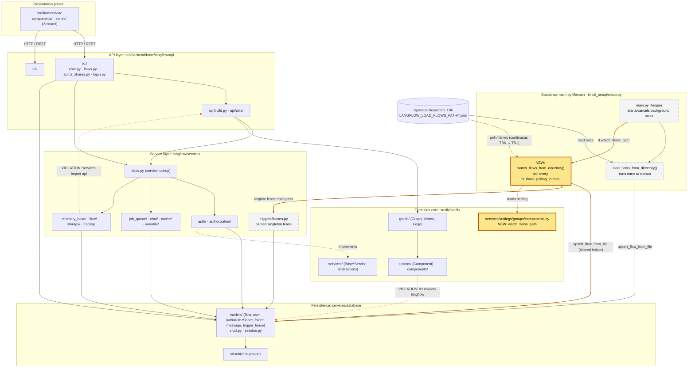

# Design note: Hot-reload flows from `LANGFLOW_LOAD_FLOWS_PATH`

| | |
|---|---|
| **Status** | Implemented |
| **Author** | Ava McDonald |
| **Date** | 2026-11-22 |
| **Base branch** | `release-1.14.0` |
| **Issue** | [langflow-ai/langflow#11918](https://github.com/langflow-ai/langflow/issues/11918), "Support dynamic reloading of flows from LANGFLOW_LOAD_FLOWS_PATH" |

This note is written as an Architecture Decision Record (ADR). It explains what was decided, why, and which alternatives were rejected, so that a reader a year from now can tell whether the reasons still hold.

## 1. Context

Operators can point Langflow at a directory of flow JSON files with `LANGFLOW_LOAD_FLOWS_PATH`. Langflow imports them into the database as flows owned by the active superuser. This is how teams deploy flows from a git repository: CI writes the files, and Langflow loads them.

Langflow reads that directory only once, during startup:

- `load_flows_from_directory()` (`src/backend/base/langflow/initial_setup/setup.py:1064-1086`) iterates the directory and calls `upsert_flow_from_file()` for each `.json` file.
- It is called once from the FastAPI lifespan (`src/backend/base/langflow/main.py:585-589`). Nothing calls it again.

Any change to the directory has no effect until the server restarts. This includes a changed file, a new file, and a removed file. The issue reporter describes Kubernetes deployments with a PVC-mounted flows directory synced by GitOps, where the workaround is `kubectl rollout restart`.

### Who asked for it

The feature was requested in issue #11918, opened 2026-02-26, with two 👍 and a "+1" comment. A Langflow team member who triages issues replied on 2026-03-06. They logged internal ticket LFOSS-3367 and wrote that "it's unlikely the team will be able to prioritize this on our end in the near term". They suggested the reporter "go ahead and open the PR yourself". The issue is open and unassigned, and no linked PR exists as of 2026-11-22.

## 2. Decision

Add an **opt-in, one-way, polling sync** from `LANGFLOW_LOAD_FLOWS_PATH` into the database:

- A new setting, `watch_flows_path: bool = False` (env `LANGFLOW_WATCH_FLOWS_PATH`), enables it. The issue reporter suggested this name and default.
- When enabled, a background task polls the directory every `fs_flows_polling_interval` milliseconds (existing setting, default 10,000).
- Each pass compares each `.json` file's modification time with the last time it was applied. The pass calls the **existing** `upsert_flow_from_file()` only for new or changed files. The rules that apply at startup also apply here: owner selection, name-match handling (`load_flows_overwrite_on_name_match`), and variable-binding preservation (`load_flows_preserve_variable_bindings`).
- Only one process performs each pass. The task uses the existing named singleton lease (`langflow.services.triggers.leases`) so that multiple workers and replicas do not race.

### Acceptance criteria

1. With `LANGFLOW_WATCH_FLOWS_PATH` unset or `false`, behavior is identical to today. No background task is started.
2. With it `true` and `LANGFLOW_LOAD_FLOWS_PATH` set, **editing** a flow file updates the matching flow within one polling interval, with no restart.
3. **Adding** a new `.json` file creates the flow within one polling interval.
4. **Removing** a file leaves the flow in place and logs a warning once. Nothing is deleted.
5. A file that is **not valid JSON** is skipped and logged once. This includes a file caught half-written. The file is retried as soon as it changes again, which is when the writer finishes. Other files in the pass still apply.
6. When the sync overwrites a flow that was **edited in the UI** since it was last applied from disk, it logs a warning naming the flow. This holds whether the flow was last applied by the watcher or by the startup load.
7. With several workers or replicas, a given change is applied by **one** process per pass.
8. Enabling the watch without `LANGFLOW_LOAD_FLOWS_PATH` logs a warning at startup and does nothing.

### What this deliberately will not do

- **Delete flows when files are removed.** Deletion is irreversible. A bad CI run that empties the directory would wipe flows and the history tied to them. Today's startup loader never deletes either. This could become a separate opt-in setting later.
- **Write UI edits back to the files.** The sync is one-way. Files are the source of truth.
- **Show an in-app notice** that a flow is file-managed or about to be overwritten. That is frontend work and is left as future work. This change logs a warning instead (criterion 6).
- **Recurse into subdirectories.** This matches the startup loader, which reads only the top level.
- **Change the default.** The goal is for this to be on by default eventually. Flipping it now would change behavior for existing users without warning (see section 7).

## 3. Alternatives considered

### 3.1 Reuse the per-flow `fs_path` sync (rejected)

Langflow already polls the filesystem: `sync_flows_from_fs()` (`setup.py:1623`) re-reads every flow whose `fs_path` column is set. The obvious change is to have the loader set `fs_path` on the flows it imports, so the existing poller picks them up. That breaks things. `fs_path` is a different feature with different rules:

- **It is two-way.** Saving a flow in the UI writes it back to `fs_path` (`_save_flow_to_fs`, `api/v1/flows_helpers.py:195`).
- **It is per-user and contained.** `_get_safe_flow_path()` (`flows_helpers.py:62`) only accepts paths inside `data_dir/flows/{user_id}`. It rejects others with *"Absolute path must be within your flows directory"* (`flows_helpers.py:117`).

The load directory is operator-owned and lives outside that data directory. So pointing `fs_path` at it would make every UI save of a loaded flow fail with HTTP 400. Loosening the containment check to allow it would let UI edits write into the operator's GitOps directory, and would weaken a path-traversal defence. One feature is a one-way operator deploy and the other is a two-way user mirror, so they should not share a mechanism.

### 3.2 OS file-change notifications (rejected)

The issue's first preference was automatic file watching with debounce, for example with the `watchdog` library. It was rejected because:

- inotify-style events are unreliable or absent on network filesystems (NFS and many CSI-backed PVCs), which is the deployment the issue describes.
- Kubernetes ConfigMap volumes update by atomically swapping a symlink, which file watchers often report confusingly or not at all.
- It adds a new runtime dependency for a feature that is off by default.
- Polling at the existing 10-second interval matches the project's own pattern (`sync_flows_from_fs`) and is cheap (section 6).

### 3.3 Admin "reload now" endpoint (deferred)

The issue's second preference was `POST /api/v1/admin/reload-flows`. It is simple and explicit. It also adds a new authenticated network entry point (see section 8), and it only helps if something remembers to call it after each deploy. It complements polling and could be added later as a separate change.

### 3.4 Run the sync in every worker and tolerate races (rejected)

`sync_flows_from_fs` runs in every worker (`main.py:622`). Copying that is simpler, but each change would be applied once per worker. For a **new** file, concurrent inserts would collide on the `(user_id, name)` unique constraint, and all but one would log errors. The existing lease gives exactly-once-per-pass behavior with less code than error handling would need.

### 3.5 Postgres advisory lock (rejected in favour of the lease)

The job service serializes work with `pg_advisory_xact_lock` (`services/jobs/service.py:245`). That only works on Postgres, so SQLite would need a second code path. The trigger lease is a single conditional `UPDATE` that its module documents as "portable across SQLite and Postgres". The `trigger_lease` table already exists, so no migration is needed.

## 4. Where it sits in the architecture

The change lives in the backend's **startup/bootstrap** code (`initial_setup/`, started from `main.py`'s lifespan). It reads from the operator's filesystem and writes to the persistence layer through the existing upsert path. It adds no API route and does not touch the execution core.

The diagram below is my logical architecture diagram from the Logical Architecture wiki page (`docs/architecture-layers.mmd`), unchanged except for the additions this feature needs:

- **Amber with a bold border** marks new code.
- **Amber edges** are new dependencies.
- **Grey dashed boxes** are existing code that the original diagram did not show, added because the feature attaches to it.
- **Red dashed edges** are the layer violations from the original analysis, left as they were.

**What the marked-up diagram shows:**

- The feature adds **no edge from the Presentation or API layers**. Nothing a user sends over HTTP reaches the new code.
- The one new input is the dotted edge from the operator filesystem. That is the trust-boundary crossing analyzed in section 8.
- The new **Bootstrap → `services/triggers`** edge is the coupling trade-off discussed in sections 5 and 9.

## 5. Existing code that changes, and what that says about coupling

| File | Change | Why |
|---|---|---|
| `src/lfx/src/lfx/services/settings/groups/components.py` | Add `watch_flows_path` next to `load_flows_path` | The settings live in `lfx`, so a backend-only feature still edits the shared settings package. |
| `src/backend/base/langflow/initial_setup/setup.py` | Add the watcher beside `sync_flows_from_fs()`. It calls the existing `upsert_flow_from_file()` and `_get_flow_import_superuser()`, and `load_flows_from_directory()` is left unchanged. | One definition of "apply this file" keeps startup and hot-reload from drifting. See section 12 for why the startup loader was not refactored after all. |
| `src/backend/base/langflow/main.py` | Start the task in the lifespan when enabled and cancel it at shutdown, the same way as `sync_flows_from_fs_task` | Every background loop is started and cancelled by hand in the lifespan function. |
| `docs/docs/Develop/environment-variables.mdx` | Document `LANGFLOW_WATCH_FLOWS_PATH` | User-facing setting. |

**What this tells us about coupling:**

- **The lifespan function is a central hub.** Adding any periodic job means editing `main.py` in two places: start and shutdown. It already manages `sync_flows_from_fs_task`, the MCP init task, the models refresh task, and the warm registry. A small background-task registry would remove that coupling. That refactor is out of scope here.
- **`initial_setup/setup.py` has low cohesion.** It is about 1,700 lines covering starter projects, bundles, profile pictures, flow loading, and the `fs_path` poller. I would have put the watcher in its own module. I am following the project's existing layout instead, which puts the similar `sync_flows_from_fs()` in this file, so a reviewer finds related code together. That is a case where the project's style decides against my preference.
- **The lease is generic but lives under `services/triggers/`.** Importing it from `initial_setup` creates a dependency from bootstrap code on the trigger feature's package. The module is self-contained (one table, keyed by loop name), so reusing it is still better than duplicating it. Moving it to a shared `services/leases` module would be a good follow-up for the maintainers to decide.

## 6. Cost

- **Per pass:** one directory listing, plus one `stat()` per `.json` file. There is no database query when nothing changed. Changed files are read, parsed, and upserted.
- **Memory:** one in-process map of file name to (modification time, 64-character content fingerprint). That is roughly 200 bytes per file.
- **Once, when the watcher starts:** each file is parsed and its flow looked up, to record the starting fingerprints. That is the same work the startup load just did.
- **Worst case:** on a network filesystem each `stat()` is a round trip, about 1 ms. A 200-file directory then spends about 0.2 seconds per 10-second interval, most of it waiting on I/O, on one process.
- **Disabled (default):** zero. The task is never created.

For comparison, the existing `sync_flows_from_fs` runs a database query every 10 seconds in **every** worker.

## 7. Backward compatibility

- **Existing users:** no change unless `LANGFLOW_WATCH_FLOWS_PATH=true`.
- **Existing data:** no schema change and no migration. `trigger_lease` gets one extra row keyed by the watcher's name.
- **Existing callers:** `load_flows_from_directory()` keeps its signature and behavior. The extracted helper is internal.
- **When enabled:** a UI edit to a file-loaded flow now survives only until the file next changes, about 10 seconds, instead of until the next restart. This matches the semantics operators already accepted at restart (the file is authoritative). It is the reason the default stays off for now, and the reason criterion 6 logs a warning.

## 8. Security

This uses the vocabulary from my security analysis: trust zones TB0-TB6 and crossings C1-C12.

- **Entry point:** no new network entry point. The input channel is the operator-controlled directory. It already crosses into the server (TB6, operator machine/build, to TB1, server) once at startup. This change makes that crossing **continuous**.
- **Asset:** the superuser's flows, including any custom component code inside them. Loaded flows are owned by the active superuser, and their code runs with server permissions when executed (Threat 1).
- **Threat (STRIDE: Tampering → Elevation of Privilege):** anyone who can write to the directory can now change a running superuser's flows within one polling interval, without needing a restart. Before this change the same write took effect at the next restart, so the **capability is not new, but the delay drops from "next deploy" to about 10 seconds.**
- **Mitigations:**
  1. Off by default.
  2. The documentation states that the directory must be writable only by the deployment pipeline. It is a code-deployment path, not an upload folder.
  3. No change to `_get_safe_flow_path`. The user-facing `fs_path` containment check stays as strict as it is.
  4. The watcher reads only regular `.json` files at the top level, exactly as the startup loader does.
- **Not addressed (same as today's startup loader):** symlinks inside the directory are followed. There is no file-size cap per flow file. Both are worth a follow-up, but changing them here would make startup and hot-reload behave differently.
- **Denial of service:** a directory with thousands of files costs `stat()` calls on one process per pass (section 6). Parsing happens only for files that changed.

## 9. GRASP principles and patterns

- **Information Expert:** `upsert_flow_from_file()` already knows how a file maps to a flow (id, endpoint name, name match, variable bindings). The watcher delegates to it instead of re-implementing that logic.
- **Pure Fabrication:** the watcher loop and its modification-time map are not domain concepts. They exist only to give "keep the database in step with the directory" a home.
- **Protected Variations:** "detect what changed" is isolated in one function. Swapping polling for file notifications later would not touch the upsert or lease code.
- **Low Coupling (traded off):** depending on `services/triggers/leases` adds a cross-package dependency (section 5). It was accepted in exchange for not duplicating subtle concurrency code.
- **Deliberately avoided:** the **Observer** pattern (OS file-change callbacks), for the reasons in 3.2.

## 10. Testing plan

- **Unit tests** for one polling pass, with a temporary directory and the test database:
  - new file creates the flow
  - changed file updates the flow
  - unchanged file is not re-applied
  - invalid JSON is skipped, then succeeds on the next pass
  - removed file is logged once and not deleted
  - a pass that does not hold the lease does nothing
  - a UI-edited flow logs a warning when overwritten
- **System test:** boot the app with `LANGFLOW_LOAD_FLOWS_PATH` and `LANGFLOW_WATCH_FLOWS_PATH=true` and a short polling interval. Change a file on disk, then read the flow back through the public API (`GET /api/v1/flows/{id}`) and check the change, the way an operator would.
- **Regression:** the existing tests for `load_flows_from_directory` / `upsert_flow_from_file` must still pass.

**Results (2026-11-22):**

| Suite | Result |
|---|---|
| Unit, `test_watch_flows_from_directory.py` | 15 passed (15.0 s) |
| System, `test_watch_flows_system.py` | 3 passed (81.6 s) |
| Regression, `test_flow_loader_owner.py`, `test_upsert_flow_from_file.py`, `test_initial_setup.py` | 71 passed (480.7 s) |
| `ruff check` on changed files | All checks passed |

## 11. Open questions for review

### Known limitation (deferred)

**When the lease moves to another process, the new holder may re-apply some files.** The process holding the lease keeps its modification-time map in memory. If it dies, the next holder starts from the files' state at its own startup. It may re-apply files that changed since then. That is idempotent for the file contents, but it could overwrite UI edits made in between without the criterion 6 warning.

The fix is to store the map in the database, for example a fingerprint per file next to the lease, so any holder can continue from where the last one stopped. It is deferred to keep this change small and reviewable.

### Settled decisions

- **Interval:** reuse `fs_flows_polling_interval` rather than adding a setting. This couples the timing of the two pollers. That is acceptable because both read the same kind of source, and operators who tune one usually want the other to match.
- **Code location:** in `initial_setup/setup.py`, beside `sync_flows_from_fs()`, following the project's layout (section 5).
- **Docs:** the project's `AGENTS.md` says implementation notes go in `docs/features/`, one file per topic, and user-facing pages go in `docs/docs/`. This change adds `docs/features/watch-load-flows-path.md` and documents the setting in `docs/docs/Develop/environment-variables.mdx`. This file (`docs/DESIGN.md`) and `docs/PR.md` are coursework, kept in a separate commit that is not part of an upstream PR.

### Still open for the maintainers

- **Lease location:** is reusing `services/triggers/leases` acceptable, or would they rather it move to a shared module first?

## 12. Revisions made while building

These are the places where the design changed once the code was written.

1. **Detecting UI edits by content, not by time.** The first design compared the flow's `updated_at` with the time the watcher last applied its file. Building it showed that `updated_at` is a timezone-less column written inconsistently. `upsert_flow_from_file` stores local time (`datetime.now(tz=timezone.utc).astimezone()`), while the model default stores UTC. On any server east of UTC the comparison would report edits that never happened. The watcher now records a SHA-256 fingerprint of the flow's name, description, and data right after applying a file, and warns when the row no longer matches it. That cannot drift with timezones, and it only fires when something a person would edit actually changed. **Lesson:** a timestamp is only comparable if every writer agrees on what it means. Check the writers before trusting the column.
2. **Startup-loaded flows needed a starting fingerprint.** Without one, the most common case would never warn: a flow loaded at startup, edited in the UI, then changed in git. The watcher now fingerprints every file's flow once when it starts (`_prime_applied_flow_files`).
3. **Invalid JSON is retried when the file changes, not every pass.** Retrying every 10 seconds would log the same warning forever for a file that is permanently broken. A half-written file gets a new modification time when the writer finishes, so recording the timestamp and waiting for the next change retries at the right moment.
4. **The startup loader was not refactored.** The plan was to extract a shared per-file step from `load_flows_from_directory()`. In practice the watcher needs the parsed file before the upsert, to check for UI edits, so it could not reuse that step unchanged. Refactoring the startup loader anyway would have changed tested code for no behavioral gain. The shared logic is `upsert_flow_from_file()`, which both paths call.
5. **A missing directory is a warning, not a crash.** If `LANGFLOW_LOAD_FLOWS_PATH` does not exist, the background task logs and exits instead of raising inside the event loop.
